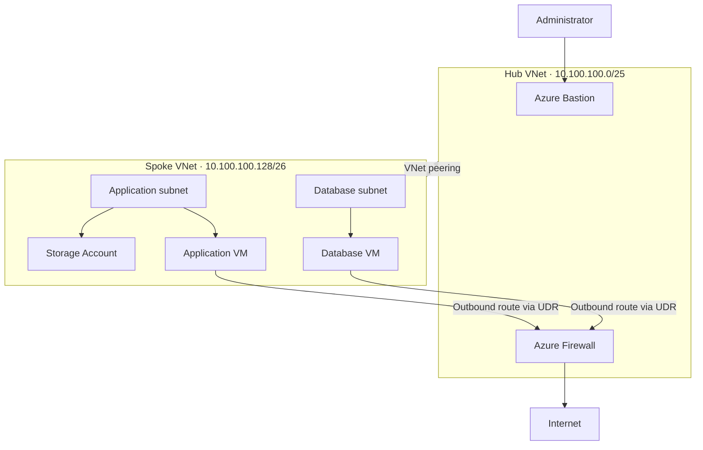

# Azure Hub-and-Spoke Network Lab

A practical Azure networking and security lab built with Terraform. The project demonstrates a centralized Hub-and-Spoke topology and provides a foundation for exploring enterprise Azure architecture, governance, and security controls.

This is a learning project, not a production-ready reference implementation. The documentation distinguishes between what the current Terraform configuration deploys and improvements that should be completed before using the design in a production environment.

## Objectives

The lab is intended to help practise:

- Designing an Azure Hub-and-Spoke network topology.
- Centralizing outbound connectivity through Azure Firewall.
- Providing administrative access to virtual machines through Azure Bastion.
- Connecting workload subnets to shared network services.
- Using Terraform modules to organize Azure infrastructure.
- Identifying the security, DNS, routing, monitoring, and operational controls needed in a larger environment.

The design is vendor- and organization-neutral. It can be used as a starting point for discussing patterns that apply to many kinds of enterprise environments.

## Architecture overview

The current configuration contains one Hub virtual network and one Spoke virtual network.



The diagram is a conceptual view of the current lab. It does not imply that every traffic path, including all east-west traffic or Private Endpoint traffic, is inspected by Azure Firewall.

## Components currently defined in Terraform

| Area | Current implementation |
|---|---|
| Resource organization | One resource group |
| Network topology | Hub and Spoke virtual networks with VNet peering |
| Hub networking | Azure Firewall and Azure Bastion |
| Workload networking | Application and database subnets in the Spoke |
| Routing | Route table with a default route to the Hub Firewall, associated with both workload subnets |
| Compute | Two Windows virtual machines in the Spoke |
| Storage | Azure Storage Account with a Blob Private Endpoint |
| Network rules | Azure Firewall network rule for ICMP from the workload subnets |
| Application rules | Azure Firewall application rule for HTTP/HTTPS using a wildcard FQDN target |
| Infrastructure as Code | Terraform root configuration and separate Hub and Spoke modules |

## Traffic flow

- The Hub and Spoke virtual networks are connected using VNet peering.
- A user can use Azure Bastion as the intended administrative entry point to the virtual machines; the VMs do not require their own public IP addresses.
- The workload subnet route table sends default-route traffic (0.0.0.0/0) to the private IP address of Azure Firewall.
- Azure Firewall rules determine which traffic is permitted through the firewall.

A default route does not automatically force every possible network flow through the firewall. Azure system routes for more-specific prefixes can take precedence. In particular, traffic between subnets and traffic to Private Endpoints need explicit routing and security design if inspection is required.

## Repository structure

```text
Hub-and-Spoke-Network/
├── README.md
├── picture/
│   └── pic1.jpg
└── terraform/
    ├── providers.tf
    ├── main.tf
    ├── variables.tf
    └── modules/
        ├── hub/
        │   ├── main.tf
        │   ├── variables.tf
        │   └── outputs.tf
        └── spoke/
            ├── main.tf
            ├── variables.tf
            └── outputs.tf
```

## Prerequisites

- An Azure subscription with permissions to create the resources in this lab.
- Terraform installed locally.
- Azure CLI installed and authenticated, for example with `az login`.
- A configured Azure subscription context.
- Sufficient quota for the selected VM sizes and networking resources.

The AzureRM provider is configured in the Terraform project. Review `terraform/providers.tf` and the input variables before deployment. Do not put real credentials or secrets in source control.

## Deploying the lab

Run the commands from the `terraform` directory:

```bash
terraform init
terraform fmt -recursive
terraform validate
terraform plan
terraform apply
```

Review the plan carefully before applying it. Resource availability, quotas, naming constraints, and Azure pricing depend on the subscription and region.

To remove the lab when it is no longer needed:

```bash
terraform destroy
```

Review the destroy plan before confirming. Back up anything that must be retained.

## Security considerations and known gaps

The current configuration is intentionally a starting point. The following items should be addressed or assessed before treating the environment as production-ready:

1. **Azure Bastion subnet sizing** — the current subnet is `/27`. Current Azure Bastion deployment requirements call for a dedicated `AzureBastionSubnet` of at least `/26`; update the address plan before deploying or recreating Bastion.
2. **Private Endpoint DNS** — the Blob Private Endpoint is defined, but the configuration still needs the Private DNS Zone `privatelink.blob.core.windows.net`, the required VNet link(s), and a Private DNS Zone Group. Validate name resolution from every network that must access the storage account.
3. **Storage public access** — a Private Endpoint does not by itself disable the Storage Account's public endpoint. Decide the intended access model and explicitly disable public network access if the account is meant to be private-only, after validating the private path and required operations.
4. **Network Security Groups** — dedicated, appropriately scoped NSGs and subnet-level traffic rules are not currently defined. Add least-privilege rules based on actual application and database dependencies.
5. **Firewall rules** — the current application rule uses `target_fqdns = ["*"]`, which is broad. Replace it with explicit destination FQDNs and ports appropriate to the workload. Use Azure Firewall Policy and a structured rule collection strategy as the design grows.
6. **Routing and east-west inspection** — the default route does not guarantee inspection of traffic between all subnets or to Private Endpoints. Define the required traffic paths, route tables, and Private Endpoint network policy settings deliberately; do not assume peering alone provides centralized inspection.
7. **Secrets and Terraform state** — VM credentials and other sensitive values must be handled carefully. Marking an output as sensitive only suppresses normal display; it does not remove the value from Terraform state. Use a secured remote backend with encryption and access controls, avoid reusing administrator passwords, and prefer Entra ID-based access or managed identities where supported.
8. **Logging and monitoring** — diagnostic settings, centralized Log Analytics, alerting, and integration with Microsoft Sentinel are not yet implemented. Define retention, access, and monitoring requirements as part of the platform design.
9. **Governance and operations** — a broader enterprise design should also consider management groups, subscription boundaries, Azure Policy, RBAC/PIM, Defender for Cloud, backup, update management, and operational ownership.

These are review findings and design recommendations; they are not claims that the controls have already been implemented in Terraform.

## Possible next improvements

The lab can be developed incrementally, validating each change with `terraform fmt`, `terraform validate`, and `terraform plan` before applying it. A sensible order is:

1. Correct the Bastion subnet address space.
2. Complete Private Endpoint DNS and decide the Storage Account public access model.
3. Add NSGs and tighten Azure Firewall rules.
4. Review routing for east-west and Private Endpoint traffic.
5. Secure Terraform state and improve identity/secret handling.
6. Add diagnostic settings, centralized monitoring, and governance controls.

## Disclaimer

This repository is for educational and demonstration purposes. It is not a Microsoft-certified architecture or a production deployment blueprint. Validate current Azure service requirements, security controls, costs, and organizational policies before adapting any part of it to a real environment.
