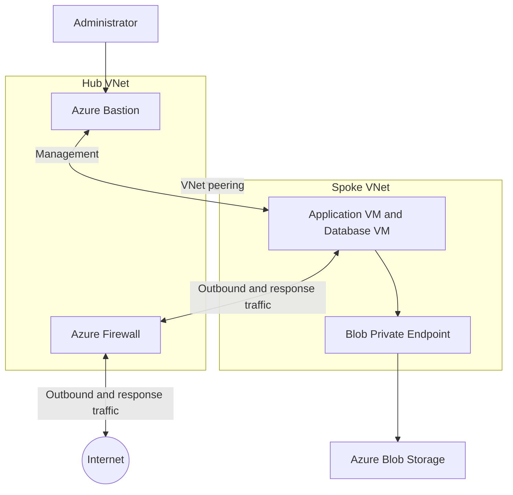

# Azure Hub-and-Spoke Network Lab

A small Azure networking and security lab built with Terraform. It demonstrates a Hub-and-Spoke topology, centralized outbound traffic, administrative access, network segmentation, and private Blob Storage access.

This is a learning project, not a production-ready landing zone.

## What the lab includes

- Hub VNet with Azure Firewall Standard and Azure Bastion.
- Spoke VNet with separate application, database, and Private Endpoint subnets.
- VNet peering and default outbound routes through Azure Firewall.
- NSGs that allow RDP only from the Bastion subnet and deny other inbound traffic.
- Two Windows VMs without public IP addresses.
- Storage Account with public network access and Shared Key access disabled.
- Blob Private Endpoint and private DNS.
- System-assigned Managed Identity on the Application VM, with `Storage Blob Data Contributor` scoped to the private `appdata` container.
- Reusable Terraform Hub and Spoke modules.

## Architecture



The Firewall arrows represent VM-initiated outbound connections and their responses, not unsolicited inbound Internet access. Private Endpoint traffic is separate from the Firewall path. The Application VM uses its Managed Identity for Blob data access.

## Network address plan

| Network | CIDR | Purpose |
|---|---|---|
| Hub VNet | `10.100.100.0/25` | Shared services |
| AzureFirewallSubnet | `10.100.100.0/26` | Azure Firewall |
| AzureBastionSubnet | `10.100.100.64/26` | Azure Bastion |
| Spoke VNet | `10.100.100.128/26` | Workloads |
| Application subnet | `10.100.100.128/28` | Application VM |
| Database subnet | `10.100.100.144/28` | Database VM |
| Private Endpoint subnet | `10.100.100.160/28` | Blob Private Endpoint |

## Important design notes

- Application and database subnets send default-route traffic (`0.0.0.0/0`) to the Hub Firewall.
- The Firewall allows HTTP/HTTPS only to FQDNs in `allowed_outbound_fqdns`. The default list contains only `www.microsoft.com`; add the destinations your workloads actually require.
- An ICMP rule is included for connectivity testing.
- No application-to-database flow is enabled by default. Add a narrowly scoped NSG rule when the required protocol and port are known.
- The default route does not guarantee inspection of all internal or Private Endpoint traffic. Review effective routes and Private Endpoint network policies if that traffic must pass through the Firewall.
- The Storage Account has public network access disabled. The private `appdata` container is accessed by the Application VM's Managed Identity; its Blob data role is scoped to that container only.
- DNS connectivity and data-plane authorization are separate: successful name resolution and TCP connectivity do not prove that Blob access is authorized.

## Repository structure

```text
Hub-and-Spoke-Network/
├── README.md
└── terraform/
    ├── providers.tf
    ├── main.tf
    ├── variables.tf
    ├── outputs.tf
    └── modules/
        ├── hub/
        └── spoke/
```

## Prerequisites and authentication

You need an Azure subscription, Azure CLI, Terraform, permissions to create the resources and assign roles, and sufficient regional quota. The project uses AzureRM provider 4.x.

Authenticate and select the subscription:

**Bash**
```bash
az login
az account set --subscription "<subscription-id>"
export ARM_SUBSCRIPTION_ID="$(az account show --query id --output tsv)"
```

**PowerShell**
```powershell
az login
az account set --subscription "<subscription-id>"
$env:ARM_SUBSCRIPTION_ID = az account show --query id --output tsv
```

Do not commit credentials, Terraform state, plan files, or secret variable files.

## Deploy

Run from the `terraform` directory:

```bash
terraform init
terraform fmt -recursive
terraform validate
terraform plan
terraform apply
```

Review the plan before applying. You can customize the outbound FQDN allowlist, for example:

```bash
terraform plan -var='allowed_outbound_fqdns=["www.microsoft.com","download.microsoft.com"]'
```

The example is not a complete Windows Update or application dependency allowlist.

VM administrator passwords are available as sensitive outputs:

```bash
terraform output -raw vm_app_admin_password
terraform output -raw vm_db_admin_password
```

Sensitive outputs are still stored in Terraform state. Protect the state file and use a secured remote backend for shared or production use.

To remove the lab:

```bash
terraform destroy
```

Review the destroy plan before confirming.

## Verify private Blob connectivity

From the Application VM:

```powershell
nslookup <storage-account-name>.blob.core.windows.net
Test-NetConnection <storage-account-name>.blob.core.windows.net -Port 443
```

Check that public network access is disabled:

```bash
az storage account show \
  --name <storage-account-name> \
  --resource-group rg-hub-spoke-lab \
  --query publicNetworkAccess
```

The expected value is `Disabled`. Test Blob data access separately using the VM's Managed Identity. Terraform creates the `appdata` container but does not upload test data.

With AzureRM 4.x, `azurerm_storage_container` configured with `storage_account_id` uses the Azure Resource Manager API. Managing Blob objects uses the Storage data plane and may require Entra ID authentication configuration; keep Shared Key access disabled.

## Production considerations

This lab intentionally omits several controls that a real environment would need:

1. **State and secrets:** Use a secured remote Terraform backend with encryption, access control, locking, and recovery. VM passwords remain in state.
2. **Administration:** Consider Entra ID-based VM sign-in, MFA, PIM, and controlled administrative identities instead of relying on local VM accounts.
3. **Network design:** Define required application/database flows and review east-west, outbound, and Private Endpoint routing.
4. **Firewall and DNS:** Consider Azure Firewall Policy and centralized private DNS for larger environments.
5. **Monitoring:** Add diagnostic settings, centralized Log Analytics, alerting, and Sentinel integration as required.
6. **Governance and resilience:** Consider Azure Policy, RBAC/PIM, Defender for Cloud, backups, updates, availability, disaster recovery, and cost controls.

## Possible next steps

- Add a narrowly scoped application-to-database rule.
- Decide whether internal and Private Endpoint traffic needs Firewall inspection.
- Configure remote Terraform state and centralized diagnostics.
- Extend the lab with Azure Policy and Defender for Cloud.

## Disclaimer

This repository is for learning and demonstration. It is not a Microsoft-certified architecture or production deployment blueprint. Validate current Azure requirements, security controls, costs, and organizational policies before using these patterns in a real environment.
