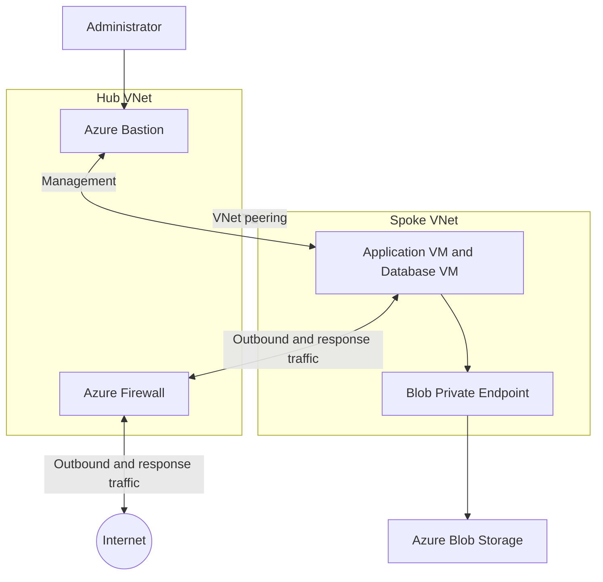

# Azure Hub-and-Spoke Network Lab

A practical Azure networking and security lab built with Terraform. The project demonstrates a small enterprise-style Hub-and-Spoke topology and selected security controls for workload networks and Azure Storage.

This is a learning project, not a production-ready landing zone or a complete enterprise reference architecture. The configuration is deliberately small enough to study, while the README calls out important design boundaries and production considerations.

## Objectives

The lab is intended to help practise:

- Designing an Azure Hub-and-Spoke network topology.
- Centralizing default outbound workload traffic through Azure Firewall.
- Providing administrative access through Azure Bastion.
- Segmenting workload subnets with Network Security Groups (NSGs).
- Accessing Azure Blob Storage through a Private Endpoint and private DNS.
- Using a VM system-assigned Managed Identity for Blob read/write data-plane authorization.
- Organizing Azure infrastructure with reusable Terraform modules.
- Reviewing routing, identity, secrets, monitoring, and governance requirements.

The design is organization-neutral and can be used as a starting point for discussing patterns that apply to many kinds of enterprise environments.

## Architecture overview

The current configuration deploys one Hub VNet and one Spoke VNet.



This high-level diagram shows only the main connections. The two-way arrows for Firewall traffic represent outbound connections initiated by the VMs and their responses; they do not mean unsolicited inbound Internet connections are allowed. Private Endpoint traffic is shown separately from the Firewall path. The Application VM uses its Managed Identity to access Blob data.

## Current Terraform implementation

| Area | Implementation |
|---|---|
| Resource organization | One resource group for this lab |
| Network topology | Hub and Spoke VNets with bidirectional VNet peering |
| Hub | Azure Firewall Standard and Azure Bastion |
| Bastion subnet | Dedicated `AzureBastionSubnet` with a `/26` prefix |
| Workload networks | Separate application and database subnets |
| Private Endpoint network | Dedicated subnet for the Blob Private Endpoint |
| Network security | NSGs on application and database subnets; RDP is allowed only from the Bastion subnet, with other inbound traffic denied |
| Routing | Default route from application and database subnets to the Hub Firewall |
| Firewall rules | ICMP connectivity-test rule and HTTP/HTTPS application rule using a configurable FQDN allowlist |
| Compute | Two Windows virtual machines without public IP addresses |
| VM credentials | Separate generated local administrator passwords for the two VMs |
| Storage | Storage Account with public network access disabled, HTTPS-only traffic, TLS 1.2 minimum, and shared-key access disabled |
| Private access | Blob Private Endpoint, Blob Private DNS Zone, VNet link, and Private DNS Zone Group |
| Workload identity | Application VM system-assigned Managed Identity with the `Storage Blob Data Contributor` role on the Storage Account |
| Infrastructure as Code | Terraform root configuration and separate Hub and Spoke modules |

## Network address plan

| Network | CIDR | Purpose |
|---|---:|---|
| Hub VNet | `10.100.100.0/25` | Shared network services |
| AzureFirewallSubnet | `10.100.100.0/26` | Azure Firewall |
| AzureBastionSubnet | `10.100.100.64/26` | Azure Bastion |
| Spoke VNet | `10.100.100.128/26` | Workload network |
| Application subnet | `10.100.100.128/28` | Application VM |
| Database subnet | `10.100.100.144/28` | Database VM |
| Private Endpoint subnet | `10.100.100.160/28` | Blob Private Endpoint |

The remaining address space in the Spoke VNet is reserved for future lab expansion. Revisit the address plan before adding more workloads or Private Endpoints.

## Traffic and security behaviour

### Administrative access

- The virtual machines have private IP addresses and no individual public IP addresses.
- The NSGs allow inbound RDP (TCP/3389) only from the configured Azure Bastion subnet.
- Other inbound traffic is denied by explicit NSG rules.
- If application-to-database communication is required, add a narrowly scoped rule for the actual database port and source subnet. No such application/database rule is assumed by this lab.

### Outbound traffic

- The application and database subnets use a route table with `0.0.0.0/0` pointing to the Hub Firewall.
- The Firewall application rule allows HTTP/HTTPS only to the FQDNs in `allowed_outbound_fqdns`.
- The default FQDN list is intentionally small (`www.microsoft.com`). Customize it for the actual software update, package, and application dependencies before expecting general outbound connectivity.
- The ICMP rule is retained for basic connectivity testing.

A default route is not a complete east-west inspection design. Azure system routes for more-specific prefixes can take precedence. Traffic between subnets in the same VNet and traffic to Private Endpoints need separate analysis and, if inspection is required, explicit routing and Private Endpoint network-policy design. Do not assume VNet peering alone sends all traffic through the Firewall.

### Blob Storage private access

- The Storage Account public network endpoint is disabled.
- The Blob Private Endpoint is placed in its own subnet.
- The `privatelink.blob.core.windows.net` Private DNS zone is linked to the Spoke VNet.
- The Private DNS Zone Group associates the Private Endpoint with the zone and maintains its DNS record.
- The application VM uses its system-assigned Managed Identity and the `Storage Blob Data Contributor` role for Blob read/write access. The Storage Account shared-key authentication is disabled.

Private Endpoint connectivity and data-plane authorization are separate controls. A successful DNS lookup and TCP connection do not by themselves prove that the caller has permission to read Blob data.


### Verifying private connectivity

From the application VM, verify that the normal Storage hostname resolves to the Private Endpoint's private IP address and that HTTPS is reachable:

```powershell
nslookup <storage-account-name>.blob.core.windows.net
Test-NetConnection <storage-account-name>.blob.core.windows.net -Port 443
```

Also verify that the Storage Account public network endpoint is disabled:

```bash
az storage account show \
  --name <storage-account-name> \
  --resource-group rg-hub-spoke-lab \
  --query publicNetworkAccess
```

The expected public network access value is `Disabled`. DNS resolution and TCP connectivity do not prove data-plane authorization; test Blob access separately using the VM's Managed Identity and an appropriate Blob data role. This lab does not create a Blob container or upload test data.

Because Shared Key access is disabled, future Terraform resources that create or manage Storage containers and blobs may need AzureRM provider Azure AD authentication configured (for example, `storage_use_azuread` where supported by the resource). Check the provider documentation for each resource before extending the lab.

## Repository structure

```text
Hub-and-Spoke-Network/
├── README.md
└── terraform/
    ├── providers.tf
    ├── main.tf
    ├── variables.tf
    ├── outputs.tf
    └── modules/
        ├── hub/
        │   ├── main.tf
        │   ├── variables.tf
        │   └── outputs.tf
        └── spoke/
            ├── main.tf
            ├── variables.tf
            └── outputs.tf
```

## Prerequisites

- An Azure subscription.
- Terraform installed locally.
- Azure CLI installed.
- Permissions to create the resources in this lab, including role assignments for the application VM's Managed Identity.
- Sufficient regional quota for the selected VM sizes and networking resources.

The project uses AzureRM provider 4.x. Authenticate with Azure CLI and set the subscription context and environment variable before running Terraform.

Bash:

```bash
az login
az account set --subscription "<subscription-id>"
export ARM_SUBSCRIPTION_ID="$(az account show --query id --output tsv)"
```

PowerShell:

```powershell
az login
az account set --subscription "<subscription-id>"
$env:ARM_SUBSCRIPTION_ID = az account show --query id --output tsv
```

Do not commit credentials, local state files, plan files, or secret variable files to source control.

## Deploying the lab

Run the commands from the `terraform` directory:

```bash
terraform init
terraform fmt -recursive
terraform validate
terraform plan
terraform apply
```

Review the plan carefully before applying it. Azure resource availability, quotas, naming constraints, permissions, and pricing depend on the subscription and region.

The outbound FQDN allowlist can be customized at plan/apply time, for example:

```bash
terraform plan -var='allowed_outbound_fqdns=["www.microsoft.com","download.microsoft.com"]'
```

Use only the destinations required by the workloads. The example list is illustrative and is not a complete Windows Update or application dependency allowlist.

The generated VM administrator passwords are exposed as sensitive Terraform outputs:

```bash
terraform output -raw vm_app_admin_password
terraform output -raw vm_db_admin_password
```

Sensitive outputs are hidden in normal Terraform display, but their values remain in Terraform state. Protect the state accordingly.

To remove the lab when it is no longer needed:

```bash
terraform destroy
```

Review the destroy plan before confirming. Back up anything that must be retained.

## Security considerations and production gaps

This lab is intentionally not a complete production landing zone. Before adapting it to a real environment, assess at least the following:

1. **Terraform state and credentials** — configure a secured remote backend with encryption, access controls, locking, and appropriate recovery. The generated local administrator passwords are stored in Terraform state. Sensitive output flags do not encrypt or remove secret values from state. Do not commit state or plan files.
2. **Administrative identity** — this lab uses local VM administrator credentials for initial access. Consider Entra ID-based VM sign-in, PIM-controlled administration, MFA, and separate operational identities for a real environment.
3. **Network flows** — the NSGs intentionally deny inbound traffic other than Bastion RDP. Add only the required application and database flows, based on documented dependencies. Review outbound NSG rules as well as Firewall rules.
4. **East-west and Private Endpoint inspection** — design explicit routing and Private Endpoint network policies if traffic inspection is required. The current default route does not provide complete inspection of all internal traffic.
5. **Firewall operations** — the lab uses Firewall rule collections directly and a small FQDN allowlist. Larger environments should consider Azure Firewall Policy, structured rule collection groups, change control, and centralized ownership.
6. **DNS architecture** — the Private DNS zone is created in the lab resource group and linked only to the Spoke VNet. Larger environments commonly centralize private DNS in a platform/connectivity subscription and link or resolve it from all required VNets and hybrid networks.
7. **Monitoring** — diagnostic settings, centralized Log Analytics, alerting, and Microsoft Sentinel integration are not implemented. Define log sources, retention, alert ownership, and incident response processes.
8. **Governance and resilience** — a wider enterprise design should consider management groups, subscription boundaries, Azure Policy, RBAC/PIM, Defender for Cloud, backup, update management, availability, disaster recovery, and cost controls.
9. **Storage data access** — the application VM's system-assigned Managed Identity has the `Storage Blob Data Contributor` role at Storage Account scope, providing Blob read/write access across the account's containers. This scope is used intentionally in this lab; production workloads should use a narrower container-level assignment when their access requirements allow it.

These are design boundaries and recommendations, not claims that the missing controls are already implemented.

## Suggested next development steps

1. Add explicit application-to-database flows after selecting the database protocol and port.
2. Decide whether internal and Private Endpoint traffic must be inspected by Azure Firewall, then implement and test the required routes and network policies.
3. Move Terraform state to a secured remote backend.
4. Add centralized diagnostics and monitoring for Azure Firewall, Bastion, NSGs, VMs, and Storage.
5. Introduce Azure Firewall Policy and a more complete enterprise DNS design.
6. Extend the lab with governance controls such as Azure Policy, RBAC/PIM, and Defender for Cloud.

## Disclaimer

This repository is for educational and demonstration purposes. It is not a Microsoft-certified architecture or a production deployment blueprint. Validate current Azure service requirements, security controls, costs, and organizational policies before adapting any part of it to a real environment.
